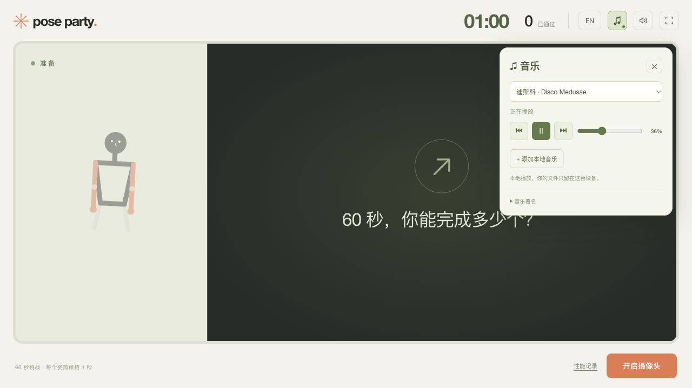

# Pose Party

**模仿姿势，挑战 60 秒。**

一个通过摄像头游玩的派对小游戏：跟随屏幕上的小人做动作，看看你能在一分钟内完成多少个姿势。项目用于 DT2140 课程，探索以身体动作为游戏输入的交互方式。

[English](README.md) · [发布指南](GITHUB-PUBLISHING.md) · [开发与实现说明](docs/DEVELOPMENT.zh-CN.md)



*界面预览：中文模式，摄像头未开启。*

## 怎么玩

1. 在桌面浏览器中打开游戏，开启摄像头并允许访问。
2. 为头部、肩膀、手肘和手腕留出活动空间；根据提示后退或站到画面中央。
3. 面向屏幕保持一秒，开始 60 秒挑战。
4. 模仿目标小人，累积一秒有效保持后得一分，再迎接下一个随机姿势。
5. 时间到后查看得分，和朋友轮流挑战。

摄像头采用镜像显示，按小人的屏幕方向模仿即可。切换姿势或追踪中断时，总计时仍继续。

## 当前功能

- **20 个随机上半身姿势**，包含六个歪头组合，相邻动作不重复。
- 开局前站位提示，以及游戏中短暂出框时的进度保留。
- 英语／中文界面切换、全屏模式和可选游戏音效。
- 三首内置纯音乐，可添加本机音频、切歌和调节音量。
- 浏览器支持时使用后台 Worker 识别，并提供页面线程回退。
- 本地性能报告，支持导出耗时、刷新频率和追踪失效类别。

## 本地运行

建议使用 **Node.js 24 LTS**，也支持符合要求的 **Node.js 22.18+**。首次试玩推荐桌面 Chrome 或 Edge，并准备摄像头。

下载或克隆项目后，在项目文件夹打开终端：

```sh
npm ci
npm run dev
```

打开终端显示的本地网址，并允许摄像头访问。开发和构建命令会自动准备固定版本的 MediaPipe 运行文件，无需手动复制。请通过本地服务运行，不要直接双击 `index.html`。

| 命令 | 用途 |
| --- | --- |
| `npm run dev` | 本地开发 |
| `npm test` | 自动检查 |
| `npm run build` | 构建到 `dist/` |
| `npm run preview` | 本地预览构建结果 |

## 发布到 GitHub Pages

项目已包含 [自动发布工作流](.github/workflows/deploy-pages.yml)。上传代码后，在仓库 **Settings → Pages → Source** 中选择 **GitHub Actions**，再按 [新手发布指南](GITHUB-PUBLISHING.md) 操作。

工作流会运行检查、构建并发布网站，同时适配 GitHub Pages 的项目子路径。上线后，把实际游戏网址填写到仓库 **About → Website** 中。

## 背景音乐

点击 **♫** 即可播放、暂停、切歌和调节音量。收起控制后音乐继续播放，每局结束会淡出暂停。背景音乐和通关提示音分别控制。

内置曲目均由 Kevin MacLeod 创作：**Disco Medusae**（迪斯科）、**Cipher**（电子）、**Cold Funk**（放克律动），按 [CC BY 4.0](https://creativecommons.org/licenses/by/4.0/) 许可使用。[完整音乐署名](public/music/CREDITS.md) 包含来源与文件校验值。

最多可添加 20 首本机音频，实际格式支持取决于浏览器。文件不上传，刷新页面后需要重新选择。

## 技术栈

TypeScript、Vite、MediaPipe Pose / Face Landmarker、Canvas 2D、Web Worker、HTML Audio 和 Web Audio。游戏在浏览器中运行，无应用后端或数据库。详细判定逻辑和性能分析方法见 [开发说明](docs/DEVELOPMENT.zh-CN.md)。

## 隐私与已知限制

- 应用在浏览器内处理摄像头画面，不录制或上传画面，也不上传本机选择的音乐。
- 性能报告默认保存在本机，只有手动导出分享才会离开设备；报告包含浏览器、粗略硬件信息和性能数据，不含画面或关键点坐标。
- 首次加载识别模型需要访问 Google 托管的模型文件，完整游戏不保证离线可用。SDK 相关说明见 [网络与隐私](docs/DEVELOPMENT.zh-CN.md#网络与隐私)。
- 光线、站位和遮挡会影响识别；摄像头视野以外的手无法可靠匹配。
- 开始确认依据头部朝向估计，不是眼动追踪，目前未实现表情匹配。

## 项目状态与许可

当前为可玩的课程原型，仍在迭代。功能范围见 [更新记录](CHANGELOG.md)。

项目代码的整体许可证尚未指定；内置音乐及第三方组件分别遵循各自许可，音乐署名需保留。
